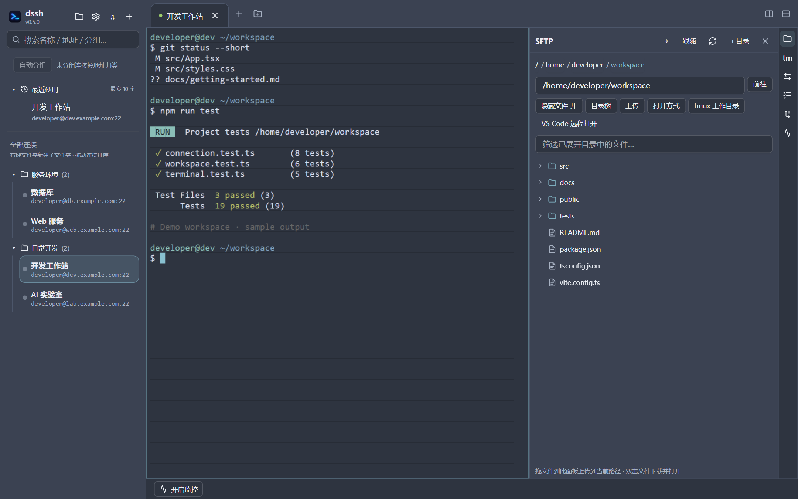
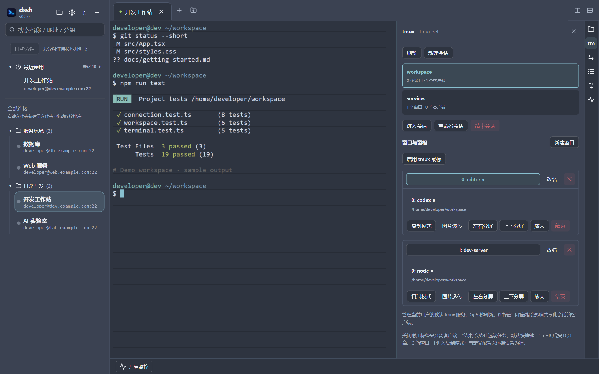

<p align="center">
  
</p>

<h1 align="center">dssh</h1>

<p align="center">Remote terminals, files and dev tasks in one workspace.</p>
<p align="center"><strong>v1.2.21</strong> · Tauri SSH client · Windows / macOS / Linux</p>
<p align="center"><strong>English</strong> | <a href="README.zh-CN.md">简体中文</a></p>

dssh is built for everyday remote development and server administration: connect to servers, keep long jobs running in tmux, edit remote files, review code diffs, and paste screenshot paths into remote tools such as Codex and Claude. For projects run by a team of coding agents, it also shows member status, task cards and model quota in the same window.

The app UI is in Chinese. This README describes features in English and gives the on-screen label in brackets where it helps you find it, e.g. Settings → Sync (「设置 → 同步」).



*Screenshot of the current frontend using fictional servers, sample files and simulated terminal output; it contains no real connection details. The other screenshots below use demo data as well.*

## ✨ Features at a glance

| You want to | dssh gives you |
| --- | --- |
| Manage many servers | Folders, search, recent connections, drag-and-drop ordering, cloning and bulk import |
| Work in several sessions at once | Tabs, side-by-side / stacked split panes, connection status and reconnect, local terminals |
| Keep remote jobs running | tmux session, window and pane management; Lead / Worker sessions auto-grouped by project; reattach after reconnecting |
| Work with remote files | SFTP file tree, upload and download (including whole folders / recursive multi-select), in-app text editing, HTML / Markdown / image preview in tabs |
| Use terminal AI tools comfortably | Screenshot upload with path insertion, inline terminal images, task status and alerts (Hooks or OSC 7501 program status, with tmux pane tracking) |
| Keep an eye on an agent team | The team panel shows each member's live state, current card and last commit, and separates "waiting on Lead", "delivered, awaiting review" and "idle, ready for work" |
| Decode task codes agents mention | Type a code in the team panel to see the task card; real codes in the terminal show status on hover and details on click (read-only taskboard) |
| Know your model quota | The Model quota panel lists remaining quota per channel on each server |
| Review project changes | Git diffs grouped into unstaged, staged and new files |
| Reach remote services | Local forwarding, remote forwarding and dynamic SOCKS5 proxy |
| Watch server health | CPU, memory, load, network, disk and process monitoring |
| Move between computers | Encrypted GitHub backup and restore of connections, credentials, private keys, task lookup and UI settings |

## 🖥️ Connections and terminals

- **Organize connections**: nested folders, search, recently used, drag to reorder or move between folders; clone an existing entry, or preview and bulk-import connection text.
- **Password and key login**: saved passwords and key passphrases go to the system credential store; pick private keys with a file chooser.
- **Parallel sessions**: open several tabs per server; rename, duplicate and bulk-close tabs. Any tab can be split into two panes, side by side or stacked.
- **Carry on after a disconnect**: connection status is always visible, scrollback survives a drop, and `R` or a button reconnects in place.
- **Restore your workspace after a restart**: tabs, splits, focus and connection folders come back; plain SSH panes try to return to their last directory, and tmux panes opened by dssh reattach to their original session. Closed tabs stay closed; plain shell processes and scrollback are not saved.
- **Local terminals**: "Open local terminal" (「打开本地终端」) on the welcome page, or tab bar `+` → "Local terminal" (「本地终端」), opens a shell on this machine (your default login shell on Linux/macOS, PowerShell on Windows), with tabs, splits and copy/paste.
- **Chinese input and themes**: CJK input works; built-in light and dark themes include Nord, Tokyo Night and Catppuccin. Font, size and theme apply instantly, and tool panels can dock left or right with adjustable width. On Linux the window uses a compact title bar that follows the theme.

## 📁 Files right next to the terminal

Browse directories, edit config, read docs, or hand a project to a local editor, all in the same window.

- **Browse and locate**: file tree, hidden-file toggle, path input and directory filter; follow the terminal's directory or pick a tmux pane's working directory.
- **Transfer and manage**: drag-and-drop upload, download, new folder, rename and delete; the upload queue shows progress and speed and can be cancelled.
- **Find what you downloaded**: the completion notice offers "Show in folder" (「打开所在目录」). A single file is revealed in Windows Explorer / macOS Finder; folder or multi-select downloads open the target directory. The notice stays until you close it or a later action replaces it.
- **Download whole folders**: right-click a directory → "Download folder…" (「下载文件夹…」), or multi-select with Ctrl/⌘ or Shift → "Download selected" (「下载所选」). Pick a local directory and the tree is downloaded recursively with its structure kept. The batch shows as one transfer with file count, bytes, speed and current file, and can be cancelled (finished files are kept). On name clashes you choose once: merge (overwrite / skip) or save as "name (1)".
- **Edit in place**: edit UTF-8 text files up to 1 MB; saving checks for remote conflicts and makes a backup first. Markdown toggles between rendered preview and source.
- **Open locally**: right-click → "Download and open" (「下载并打开」) opens the file in a local app; you can also open the current remote directory with VS Code Remote - SSH.
- **Web page tabs**: select an absolute path to a remote HTML file, or a `file:///…html` URL, in the terminal, then Shift+right-click → "Open in a new dssh tab" (「在 dssh 新标签页打开」). The file is read over the current SSH connection and shown in an isolated page that you can reload, switch to and close without touching the terminal. Single-file UTF-8 HTML up to 1 MB is supported; images, CSS and other files next to it are not loaded yet, and web tabs are not restored after a restart. Selected HTTP(S) URLs can be embedded too; for sites that refuse embedding, use the system browser.
- **Markdown and image tabs**: the same menu handles `.md/.markdown/.mdown` and PNG, JPEG, GIF, WebP, BMP, SVG, ICO and AVIF. Markdown renders tables, code blocks and images referenced by remote relative paths; images fit the window or show at original size. Documents are limited to 1 MB of UTF-8 and images to 20 MB each; supported image formats depend on the system WebView.
- **Preview from SFTP**: double-click an HTML, Markdown or image file, or right-click → "Open in a new dssh tab". "Download and open" is still there when you want a local app; other files keep the usual double-click download-and-open behaviour.

Dropping a folder uploads it recursively, keeping subdirectories and empty directories. Changes made in a local app after downloading are not uploaded back automatically. See [File workspace](docs/file-workspace.md) and [VS Code remote open](docs/vscode-remote.md) (Chinese).

## 🔁 Keep your work alive with tmux



- Discovers remote sessions automatically; create and rename sessions, or attach to one in a new tab.
- Manage windows and panes: switch focus, split side by side / stacked, zoom and restore, enter copy mode.
- **Grouped by project**: manual groups (stored in the session's `@dssh_group` option) come first. Other sessions are sorted by name: `<project>-lead` or `lead-<project>` goes into **Leads** (expanded by default, shown as the project name), and worker sessions such as `worker-<project>-<machine>-<tool>` go into **Workers**, split into one collapsible sub-folder per project with a count (collapsed by default). Cards show the short name with the full name on hover. Order: manual groups → Leads → Workers → ungrouped.
- Closing an attached tab only detaches this client, so remote jobs keep running; after a network drop dssh retries up to three times.
- Enable mouse mode for the selected session, or image passthrough for a specific pane.

tmux must be installed on the server; dssh manages the default socket. Image passthrough needs tmux 3.3+ and support from the remote program. See [tmux guide](docs/tmux.md) (Chinese).

## 🖼️ Terminal AI tools, made easier

**Screenshot → paste into the terminal → uploaded to the server → image path inserted → add your question and send.**

Copy a screenshot and paste it into the target terminal: dssh uploads the PNG and inserts its absolute remote path without pressing Enter. PNGs up to 20 MB are supported; whether the image can be read is up to the remote tool and model.

Programs that speak the Kitty graphics protocol can show images right in the terminal; double-click one to open a preview window.

With the tool panels on the right you can follow task progress and code changes side by side:

- **Task status and alerts** (「任务状态与提醒」): see terminal activity, disconnects and tool notifications; click a task card to jump back to its pane; desktop notifications are optional. Done, error or waiting states inferred from terminal text are clearly marked as inferred.
- **Unified AI status**: connect Claude, Codex and pi events per server in the task panel to see working, waiting for confirmation, turn finished and exited in one place. Integrations can be removed, and existing Hooks are preserved. [Setup](docs/ai-status.md) (Chinese)
- **OSC 7501 program status**: programs that implement the [Program Status Protocol](docs/program-status.md) report their state straight to the terminal (idle, working, needs attention, done, error, optionally with progress), no Hooks needed. With a tmux build carrying the `pane_ps_*` patch, dssh reads every pane read-only (hidden windows included), and clicking a card or alert jumps to the exact window and pane. Stock tmux can forward reports one-way via DCS passthrough; those are attributed to the attached tab only.
- **Code changes** (「代码修改」): pick a remote Git project and view unstaged, staged and new files; click a file to see its diff. The panel is read-only and covers all changes in that worktree.

See [Workspace tools](docs/workspace-tools.md) and [Program status and tmux](docs/program-status.md) (Chinese).

## 👥 Agent teams, tasks and quota

Optional **Agent collaboration** (「Agent 协作」) is configured per tmux session + worktree under Settings → Agent collaboration (「设置 → Agent 协作」). It shows shared tasks and handoffs from a taskboard server you configure, and lets you search, preview, send and reply to messages through amail. It is off by default and credentials stay on the server. See [Agent collaboration](docs/agent-collaboration.md) (Chinese).

**Team panel** (「团队」): configure a team service URL and project subscriptions in Settings → Agent collaboration. Members and their live state arrive through WebSocket independently of the current terminal's tmux session. Open a registered member's tmux session across servers in one click ([details](docs/agent-collaboration.md#从-lead-跳转到成员终端)).
The "Activity" (「动态」) and "Members" (「成员」) pages use service status. Only members explicitly reported as `no_agent` fall back to the configured taskboard's read-only session collector (`GET /api/v1/agent-sessions`); taskboard data also provides current cards and recent commits.

**v1.2.21:** The configurable team service supplies live rosters and status over WebSocket, with member editing and conflict handling. Reading and writing the Lead's local roster over SSH has been removed. Local AI summary generation is disabled; generation will move to the server.

- Members are grouped by state: **Needs attention** (「需要处理」: stuck, a confirmation prompt, unsent input, or a session that is gone while its card is still in progress) is listed first and highlighted; **Waiting on Lead** (「等 Lead」: the worker is idle but its card is still in progress or blocked, longest wait first); **Delivered, awaiting review** (「已交付·待验收」: the card is in review); running; **Idle, ready for work** (「空闲·可派活」: no card in progress, blocked or in review). The Lead's own session has its own group.
- A summary line at the top: needs attention N · waiting on Lead N (longest X) · in review N · ready for work N.
- The Lead's hand-written "currently doing" note appears as "Lead note" (「Lead 备注」) with its age, flagged "may be stale" (「可能过期」) after 24 hours. Service connection status and cached data remain visible when offline.
- Previously cached AI summaries remain read-only.

**Task code lookup**: when an agent just says "T1090" or "AM-42", type the code at the top of the team panel to see its title, column, owner, brief, review verdict, blocker and prerequisites.
With a project locked, the number alone is enough (`1090` becomes `T1090`); otherwise type "project code", or just the code for an exact cross-project match.
Codes in the terminal that really exist on that project's board are recognised: hover for a short card, click for the full one; "Open in board" (「在看板中打开」) opens that task's detail in the web board. Set the board address under Settings → Task lookup (「设置 → 任务查询」).
See [Task code lookup](docs/agent-collaboration.md#任务编号查询) (Chinese).

**Model quota panel** (「模型额度」): from the right-hand tool rail, dssh streams its bundled [`model-quota`](tools/model-quota/) script to each connected SSH server over stdin and runs it with `python3 - --json` (a fixed, read-only command with a 75-second limit; stderr is discarded). The script reads the credentials that Claude Code, Codex, Cursor, pi and Antigravity already keep on that server, so quota is reported per account where it lives. Every channel is converted to **percent remaining**: yellow at ≤ 25%, red at ≤ 10%, and failures show a scrubbed reason. Accounts are masked, and an account seen on several servers is marked "shared with X" (「与 X 共用」). With several servers you can pick one or view them side by side; refresh manually, or let it refresh every 5 minutes while the panel is open and the window is visible.
The server only needs `python3` (3.8+); nothing is installed there. Optional settings such as a proxy for non-interactive SSH or a new-api relay address go in `~/.config/model-quota/config` on the server (see the [script README](tools/model-quota/README.md)). **Copy prompt** (「复制提示词」) copies a message for the terminal AI on that server describing what is failing there (no python3, no proxy, expired login, unconfigured relay…) and how to fix it, then asks it to run the script and report; it contains no credentials or accounts. Local terminals are not supported.

For the worktree, onboarding, claiming and handoff workflow for Claude Code, Codex CLI and pi, see the [Agent playbook](docs/agent-playbook.md) (Chinese).
Settings → Agent collaboration lets you read it offline, copy it to an agent in one click, or save the full Markdown playbook.

## 🌐 Forwarding, monitoring and sync

| Feature | How to use it |
| --- | --- |
| **Port forwarding** | Create local / remote forwards or a dynamic SOCKS5 proxy; rules are saved per server and can be edited, toggled and started automatically on connect. |
| **Server monitoring** | The bottom bar shows CPU, memory, disk and network rates; expand it for trends, load, network interfaces, disk I/O and processes. |
| **Encrypted sync** | Under Settings → Sync (「设置 → 同步」), enter a GitHub repository, access token and sync password; upload a full backup and restore it on another computer. |

Sync covers connections, folders, saved passwords, referenced private keys and passphrases, forwarding rules, task lookup settings (board address, locked project, project bindings), themes and layout. Everything is encrypted locally with an Argon2-derived key and AES-256-GCM before upload. **Restoring replaces this computer's connection list**; running SSH / tmux processes are not part of the backup. See [Full encrypted sync](docs/full-sync.md) (Chinese).

## 🚀 Getting started

1. Install and launch dssh, click `+` on the left to add a server, and fill in the address, user name and authentication.
2. Double-click the server to connect; open more tabs or split panes when you need more room.
3. Use the tool rail beside the terminal to open the files, tmux, team, tasks, code changes, port forwarding, monitoring or model quota panels.

Local terminals do not offer SFTP, SSH monitoring, forwarding or model quota, and do not support screenshot paste yet. Closing a pane ends its shell; reopening the app starts a new one.

Installers and build logs are on the repository's [Releases](https://github.com/hendyzone/dssh/releases) and [Actions](https://github.com/hendyzone/dssh/actions) pages. The build covers Windows, macOS and Linux; check the build artifacts for the platforms actually available.

<details>
<summary>Run and build from source</summary>

The app lives in `apps/desktop` and is built with Tauri 2, React, ghostty-web and russh.

You need Node.js 22, stable Rust and the Tauri 2 system dependencies for your platform. Windows also needs the C++ build tools, WebView2 and NASM; for the Linux package list see the [build workflow](.github/workflows/build-windows.yml).

```bash
cd apps/desktop
npm ci
npm run tauri dev
```

Build installers:

```bash
npm run tauri build
```

Installers are written to `apps/desktop/src-tauri/target/release/bundle/`.

</details>

<details>
<summary>More docs and project layout</summary>

The documents below are written in Chinese.

- [Bulk-import SSH connections](docs/ssh-import.md)
- [File workspace and screenshot paste](docs/file-workspace.md)
- [Tasks, code changes and Markdown](docs/workspace-tools.md)
- [AI status Hooks](docs/ai-status.md)
- [OSC 7501 program status and tmux](docs/program-status.md)
- [tmux session management](docs/tmux.md)
- [Agent collaboration: taskboard and amail](docs/agent-collaboration.md)
- [Agent playbook](docs/agent-playbook.md)
- [VS Code remote open](docs/vscode-remote.md)
- [Full encrypted sync](docs/full-sync.md)
- [Architecture](docs/architecture.md)

| Path | Contents |
| --- | --- |
| `apps/desktop` | Desktop app |
| `vendor/ghostty-web` | Terminal component with Kitty graphics support |
| `docs` | Feature guides and design docs (Chinese) |
| `prototypes/kitty-image` | Early prototype validating the terminal image protocol |

</details>

## License

[MIT](LICENSE) © 2026 hendyzone

Third-party components are listed in [THIRD_PARTY_NOTICES](THIRD_PARTY_NOTICES).
