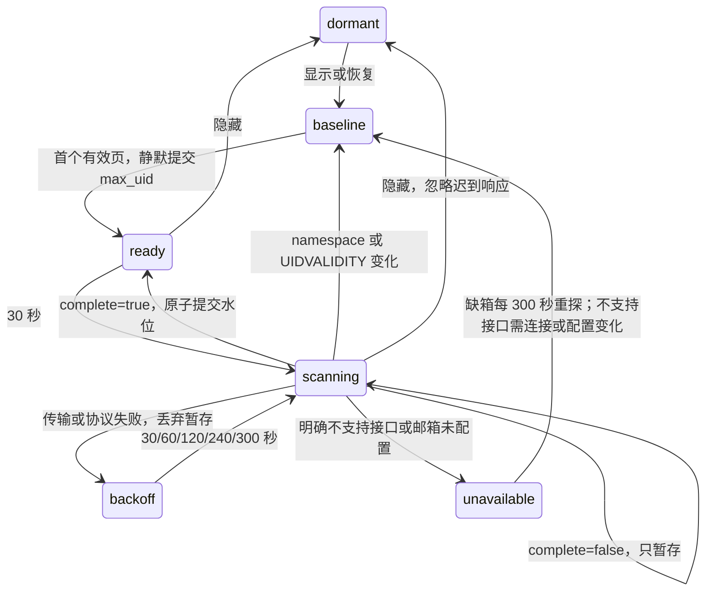

# 办公室邮件展示

办公室显示已绑定邮箱收到的信。只有主窗口在房间打开或独立窗口存在、且主窗口可见时读取。独立窗口只接收工位端点、类型、计数和邮件序列，不接收邮箱地址、主题或正文。

首次读取、邮箱代次变化及隐藏恢复只用首个有效页的 `max_uid` 建立基线，不翻历史。普通增量固定该轮水位，每源每轮最多五页，全局最多两个未完成远端请求。相同 namespace 与 UIDVALIDITY 的别名共用水位；隐藏不释放仍在执行的请求槽位。

读取使用 `inbox --json --headers-only --no-ping`。单个 `invalid_header` 或 `missing_header` 错误必须是游标之后、固定水位以内的首个失败 UID，才确定性跳过并继续；坏信不产生动画或失败计数。UID 数字间隙合法。`fetch_failed`、传输和协议错误进入退避，不提交暂存水位。明确 argparse 不识别新参数时标为不支持，不回退旧文本；`mailbox is not provisioned` 显示不可用，并在可见时每 300 秒重探；远端建箱后无需改本机配置即可恢复，首个有效页仍只建立静默基线。任一来源可用则整体显示已连接。

目标只由 `namespace.account` 与工位邮箱地址精确唯一匹配，不区分 Lead 或 worker，也不依赖 To、Cc、主题或角色别名。无唯一邮箱主人工位时该来源不飞，连接状态不受影响；发件人缺失或歧义从边缘信箱飞入。多 To 和 Cc-only 都只表示邮箱主人收到一封信，不拆成多次投递；不展示反向发信。

完成的事务在固定 300ms 窗口内合并为一个有界批次，最多五个信封，其余为本批计数；每批使用新序列，计数不与上一批相减。该间隔大于独立窗口发布器的 250ms 合并窗口，避免同期来源互相覆盖。隐藏或代次变化清除未发布批次。子窗口首次快照和恢复只记序列，不重放旧批次；动画关闭或减少动态效果时保留静态提示。
