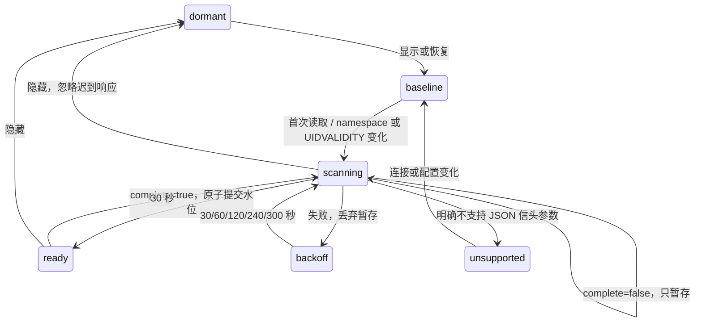

# 办公室邮件展示

只有主窗口在房间打开或办公室独立窗口存在、且主窗口可见时读取邮件。独立窗口只接收工位端点、邮件类型、投递计数和独立序列，不接收邮箱地址、主题或正文。

首次完整读取、邮箱代次变化及隐藏恢复只建立基线，不重放历史。每源每轮最多五页，全局最多两个未完成远端请求；隐藏不释放仍在执行的请求槽位。相同 namespace 与 UIDVALIDITY 的别名共用水位，失败页不推进水位。

信头接口只使用 `inbox --json --headers-only`。只有失败调用明确报告 argparse 不识别新参数时标为不支持，不回退旧文本；网络或 JSON 错误进入退避。From/To 是可见信头，不代表认证身份或 Bcc 收件人。按完整地址匹配唯一工位；缺失或歧义指向边缘信箱，支持跨项目投递。只忽略专用心跳头分类的 ping。

每批最多五个信封，其余显示计数。动画关闭或减少动态效果时仍保留静态投递提示。子窗口首次快照及恢复只记序列，不重放旧批次。
